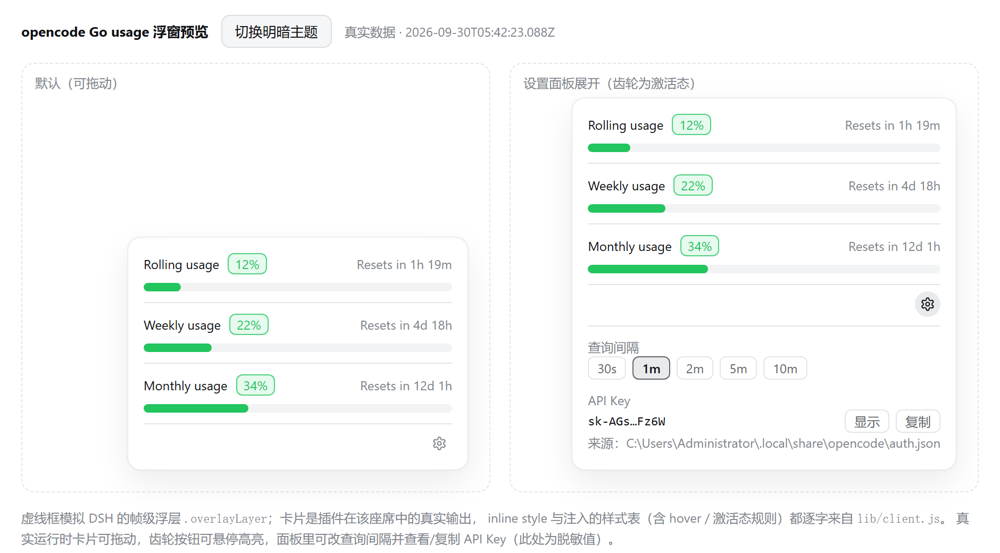
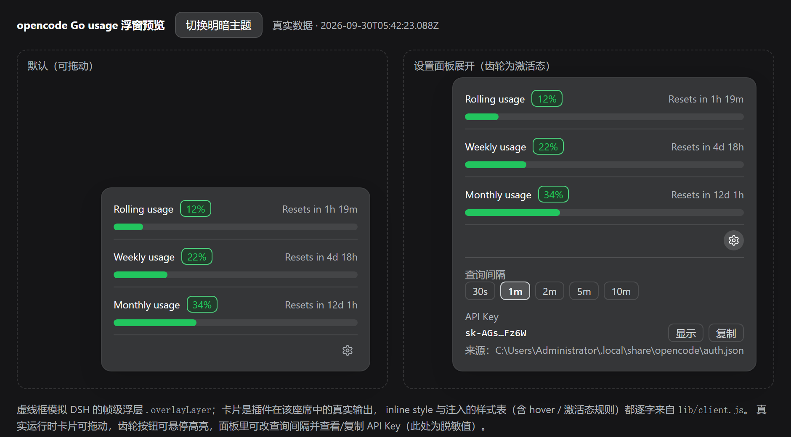

# dsh-opencode-go-usage

> 在 [DeepSeek Harness](https://github.com/deepseek-ai/deepseek-harness) 的窗口角落挂一个浮窗，实时盯住 **opencode Go 套餐**的滚动 / 每周 / 每月用量。

[](LICENSE)


| 浅色 | 深色 |
| --- | --- |
|  |  |

不想安装也能先看效果：用浏览器打开 [`preview.html`](preview.html)，里面是真实数据渲染的两种状态，还带明暗主题切换按钮。

---

## 功能

- **三窗口用量一目了然** — `Rolling usage` / `Weekly usage` / `Monthly usage` 垂直排列，每行是「标签 + 百分比徽章 + 重置倒计时 + 进度条」。
- **实时倒计时** — 按 `resetsAt` 现算：不足 1 天显示 `3h 8m`，超过 1 天显示 `4d 20h`。
- **打满即预警** — 某个窗口达到上限（`status: rate-limited` 或 `percent ≥ 100`）时，该行徽章与进度条转为错误色。
- **浮窗可拖动** — 拖到任意角落，位置记在浏览器里，刷新后还在；窗口变小时自动拉回可视区域。
- **查询间隔可调** — `30s / 1m / 2m / 5m / 10m`，改完立即生效并持久化。
- **API Key 可见可复制** — 面板里默认显示脱敏值，点一下看明文、一键复制，并标出 Key 来自哪个环境变量、DSH 凭据的哪一层或哪个文件。
- **换 Key 自动跟随** — 在 DSH 设置页换 Key 后，下一次轮询就用新值，面板里显示的 Key 也会自动重取（`auth.json` 改动同理），不用重启。
- **跟着主题走** — 颜色全部取自 DSH 主题 token，明暗主题自动适配，不写死任何颜色值。
- **失败不闪屏** — 已经成功取过数，后续某次请求失败时保留旧读数，只把错误挂到悬停提示里。

## 安装

**前置条件**：已安装 DeepSeek Harness（桌面版或 `dsh` CLI），并且 opencode 已登录 —— 也就是 `auth.json` 里存在 `opencode-go` 凭据，或已设置对应环境变量。

本仓库是一个 **DSH bundle**：`package.json` 里声明了 `dsh.bundle.patch`，插件自带的 [`cordis.patch.yml`](cordis.patch.yml) 会把自身 entry 插进 cordis 组合树。因此**不需要手工编辑 profile 的 `cordis.patch.yml`**，也不会被宿主覆盖。

### 桌面版（推荐）

在 DSH 桌面版的**插件管理界面**里，以本仓库目录作为本地来源安装。识别到 `dsh.bundle` 后，安装器会自动把它登记进该 profile 的 `dsh.profile.bundles`。安装后**重启应用**。

### 命令行

```sh
dsh plugin --profile <profile> add "link:/绝对路径/dsh-opencode-go-usage"
```

因为声明了 `dsh.bundle`，`dsh plugin add` 会自动把它写进该 profile `package.json` 的 `dsh.profile.bundles`，同样不用改 `cordis.patch.yml`。

> **把仓库放在 profile 目录之外**，通过 `link:` 或安装器引入。不要直接拷进 profile 目录。

### 卸载

在插件管理界面卸载，或：

```sh
dsh plugin --profile <profile> remove dsh-opencode-go-usage
```

若手工清理，需同时移除 profile `package.json` 里的 `dependencies` 与 `dsh.profile.bundles` 条目、`node_modules` 下的链接，然后重跑一次 `pnpm install`。

## 使用方法

### 浮窗

安装后浮窗默认出现在窗口**右下角**，每 60 秒自动刷新一次。它挂在 DSH 的帧级浮层座席 `shell.overlay` 上，与会话无关 —— 没有打开任何会话时同样显示。

### 拖动

按住卡片主体拖动即可换位置（位移小于 4px 视为点击，不会误拖）。位置存进 `localStorage`，刷新后保持。想回到默认位置，清掉 `dsh.opencodeGoUsage.pos` 即可。

### 设置面板

点右下角的**齿轮按钮**展开：

| 区域 | 操作 |
| --- | --- |
| **查询间隔** | 点 `30s / 1m / 2m / 5m / 10m` 中的一项，立即重建轮询定时器 |
| **API Key** | 点「查看」加载 → 默认显示脱敏值（如 `sk-AGs…Fz6W`）→ 点「显示」切明文 → 点「复制」写入剪贴板（成功后按钮短暂变为「已复制」）→ 点「刷新」重新读取（宿主换过 Key 时面板会自动跟进，失败时这里显示「重试」）|
| **来源** | 显示 Key 来自哪个环境变量、DSH 凭据的哪一层，或哪个 `auth.json` |

悬停卡片可看到各窗口的剩余百分比、上次刷新错误与操作提示。

## 配置

### API Key 从哪来

每次刷新都重新解析（不缓存 Key），按顺序取第一个命中的：

1. 环境变量 `OPENCODE_GO_API_KEY`
2. 环境变量 `OPENCODE_API_KEY`
3. **DSH 托管的凭据**（`ctx.credentials` → `$DSH_HOME/.credentials.yaml` 里的 `OPENCODE_GO_API_KEY`）—— 在 DSH 设置页填 / 换 Key 写的就是这里
4. 环境变量 `OPENCODE_AUTH_CONTENT`（整份 `auth.json` 的 JSON 字符串）
5. `%USERPROFILE%\.local\share\opencode\auth.json` 里的 `["opencode-go"]`（`key`，oauth 凭据则取 `access`）

第 3 项让「在 DSH 里换 Key」变成自动的：DSH 的托管凭据文档**不会**写回进程环境，只走这条 seam 才能读到新值，所以插件每次取数都 `resolve` 一次，无需重启。第 5 项是 opencode 自己的凭据文件位置，也可以用 `XDG_DATA_HOME` 重定位。**只要 opencode 已登录、或在 DSH 里配过 Key，通常无需任何额外配置。**

面板里「来源」一行会写明当前用的是哪一层（例如 `OPENCODE_GO_API_KEY（DSH 凭据 / file）` 或 `…\opencode\auth.json`）。

### 换了 Key 之后多久生效

| 改 Key 的位置 | 是否自动生效 | 说明 |
| --- | --- | --- |
| DSH 设置页 / 凭据存储（`.credentials.yaml`） | ✅ 自动，**无需重启** | 下一次轮询就用新值，面板里显示的 Key 也会跟着重取 |
| opencode 重新登录改写 `auth.json` | ✅ 自动 | 同上（只要环境变量那一层没有更高的 Key 压着） |
| `OPENCODE_GO_API_KEY` / `OPENCODE_API_KEY` 环境变量 | ⚠️ 需重启 DSH | Node 的 `process.env` 是启动快照，改系统环境变量对已运行进程无效 |

生效延迟 = 宿主 30s 数据缓存 + 页面轮询间隔（默认 60s，可在面板改到 10m）。旧 Key 失效后，卡片会保留最后一次读到的数字（不闪空白），悬停可在提示里看到 401。

### 环境变量

| 变量 | 作用 |
| --- | --- |
| `OPENCODE_GO_API_KEY` | 首选 API Key |
| `OPENCODE_API_KEY` | 备用 API Key |
| `OPENCODE_AUTH_CONTENT` | 直接以 JSON 字符串提供 `auth.json` 内容 |
| `XDG_DATA_HOME` | 重定位 `opencode/auth.json` 所在目录 |

### 浏览器侧持久化

| `localStorage` 键 | 内容 |
| --- | --- |
| `dsh.opencodeGoUsage.pos` | 浮窗位置 `{x, y}` |
| `dsh.opencodeGoUsage.intervalMs` | 查询间隔（毫秒）|

## 常见问题

**浮窗一直显示「opencode Go usage 不可用」**
取数从未成功过。先确认 `curl -H "Authorization: Bearer $KEY" https://opencode.ai/zen/go/v1/usage` 能返回 200。

**提示 401**
Key 无效或已失效。

**提示 403**
Key 本身有效，但该账号没有 opencode Go 套餐（Zen 与 Go 共用同一个 workspace key，所以这个错误是「有 key、无套餐」）。

**点「查看」显示读取失败**
「查看 Key」依赖宿主侧的 `/key` 路由。如果你刚更新过插件，**重启一次 DSH** 让新的宿主代码生效 —— 宿主侧模块不像前端 bundle 那样热更新。重启后仍失败可以点「重试」。

**不想让明文 Key 进入页面**
删掉 `lib/index.js` 里 `/key` 分支即可，此时面板会显示读取失败而不是崩溃。详见下方「安全说明」。

## 工作原理

浏览器直连上游会撞 CORS，而且 API Key 不该下发到页面，所以插件拆成两半：

| 半边 | 文件 | 职责 |
| --- | --- | --- |
| Host (Node) | [`lib/index.js`](lib/index.js) | 解析 Key（环境变量 → DSH 凭据 seam → `auth.json`）→ 带 `Bearer` 请求上游 → 归一化成稳定小契约 → 通过同源路由输出；含 30s 缓存与并发合并 |
| Browser | [`lib/client.js`](lib/client.js) | 按可配间隔轮询同源路由，渲染浮窗，处理拖动 / 间隔 / Key 交互 |

上游只返回**已用百分比**，没有 `used` / `limit` / `remaining`，所以剩余量按 `100 - percent` 算。另外 `percent === 0` 时上游给的 `resetsAt` 只是「当前时间 + 窗口长度」的占位值，不是真实重置时间，插件会把它丢弃。

两个端点共用一条同源 `prefix` 路由：

```
GET /opencode-go-usage        用量
GET /opencode-go-usage/key    凭据（仅点「查看」时请求一次）
```

两者都做同源校验（拒绝 `sec-fetch-site: cross-site` / `same-site`，`Origin` 存在时必须与 `Host` 同源），未知子路径返回 404。

### 为什么是浮窗，而不是贴在「上下文已用」旁边

DSH 的「上下文已用」圆环（`ContextMeter`）**硬编码**在 composer 工具行里，顺序是 `input.right` → `input.model` → 圆环 → 发送按钮 —— **圆环之后没有座席**，插不进去。

于是改用帧级浮层座席 `shell.overlay`（`list` / root scope）：它是 DSH 为「属于自己的帧级表面」预留的座位，与会话无关，正好匹配账号级的用量数据。

### 安全说明

`/key` 端点会把**明文密钥**交给页面。它只接受本机同源请求，但这是「查看 / 复制 Key」功能无法回避的代价。如果你不接受，删掉 `lib/index.js` 里的 `/key` 分支即可，其余功能不受影响。

## 设计

颜色全部取自 DSH 主题 token，不写死颜色值：

| 元素 | token |
| --- | --- |
| 进度条填充 / 徽章文字 | `--dsw-alias-state-success-primary` |
| 徽章背景 | `--dsw-alias-state-success-tertiary` |
| 徽章描边 | `--dsw-alias-state-success-secondary` |
| 进度条轨道 / 按钮高亮 | `--dsw-alias-interactive-bg-hover` / `--dsw-alias-interactive-bg-active` |
| 卡片面 / 边框 / 阴影 | `--dsw-specific-menu` / `--dsw-alias-border-l1` / `--dsw-shadow-lv3` |
| 行与面板分隔线 | `--dsw-alias-border-l2` |

`:hover` 和 `[data-active]` 这类状态样式无法用 inline style 表达，因此插件在物化时注入一张 `<style>`（规则见 `lib/client.js` 的 `STYLE_TEXT`）。DSH 的模块系统会自动认领未标记的 `<style>`，并在插件卸载时移除。

## 开发

```
dsh-opencode-go-useage/
├── package.json          # dsh.bundle（自带 patch 层）+ dsh.client 声明
├── cordis.patch.yml      # bundle 自带 patch：把本插件 entry 插入组合树
├── lib/
│   ├── index.js          # Host 侧：取数 + 同源路由
│   ├── index.d.ts        # Host 侧类型
│   └── client.js         # Browser 侧：轮询 + 浮窗
├── preview.html          # 两态预览（浏览器直接打开）
├── preview.png / preview-dark.png
├── verify.cjs            # 行为验证脚本
├── LICENSE
└── README.md
```

### 测试

```sh
node verify.cjs
```

只用 Node 内置模块（`fs` / `path` / `vm`），无需安装依赖。Client 半在 `vm` 沙箱里模拟浏览器环境（`__ModuleLoader__`、定时器、可编程 `fetch`、`localStorage`、`navigator.clipboard`、事件监听、极简 React stub），Host 半用带 cache-busting 的动态 import 反复加载。

**25 个用例**覆盖渲染结构、样式断言、拖动、间隔切换、Key 查看 / 复制 / 刷新与换 Key 后自动跟进、路由注册、上游归一化、401/403 映射、TTL 缓存、凭据优先级（env / DSH 凭据 / auth.json）、405 与 404。

### 可调常量

`lib/client.js`：`DEFAULT_INTERVAL_MS`、`INTERVAL_OPTIONS`、`DRAG_THRESHOLD`、`CARD_STYLE`（浮窗默认位置）。
`lib/index.js`：`CACHE_MS`、`ERROR_CACHE_MS`、`UPSTREAM_TIMEOUT_MS`、`USAGE_URL`。

## 许可证

[MIT](LICENSE)
